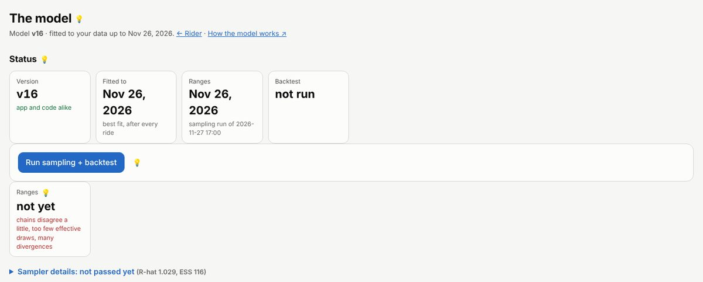
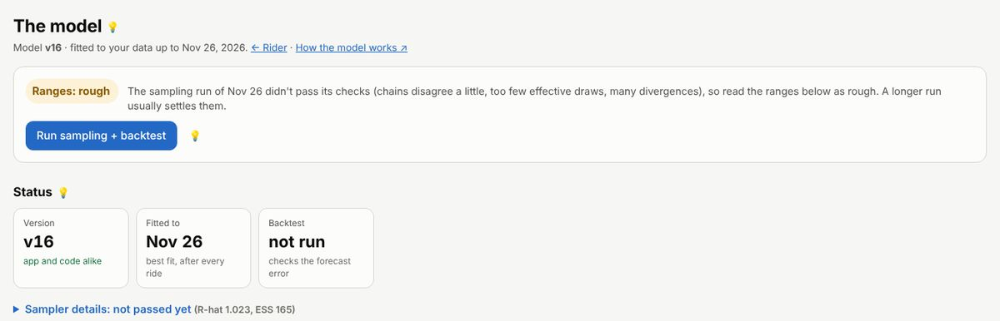
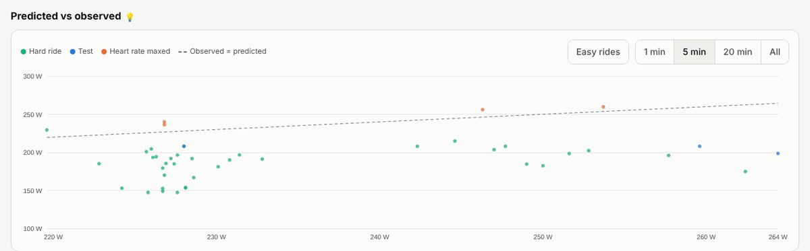
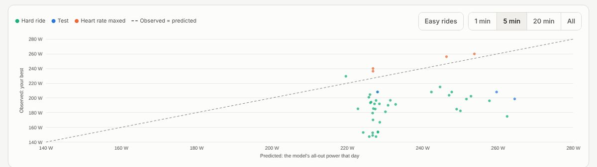
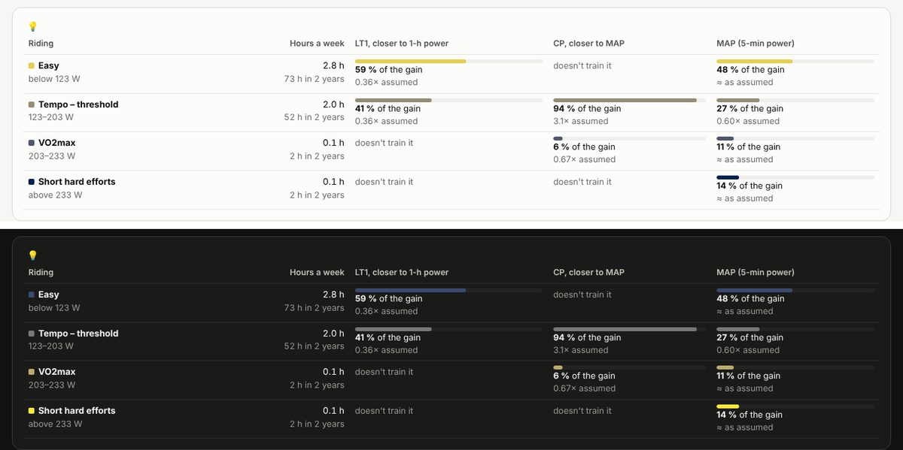
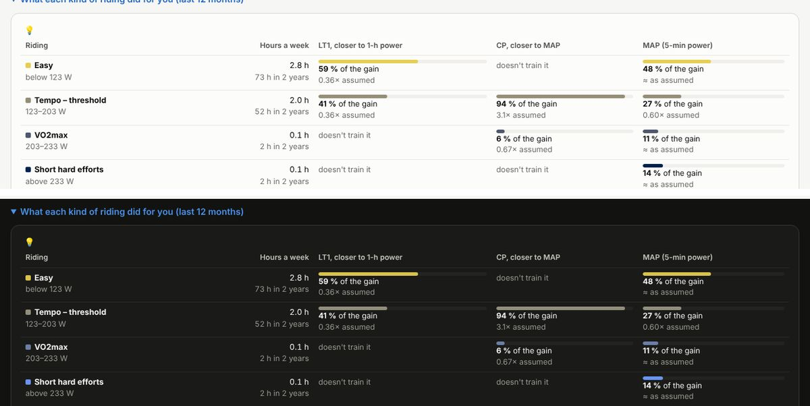
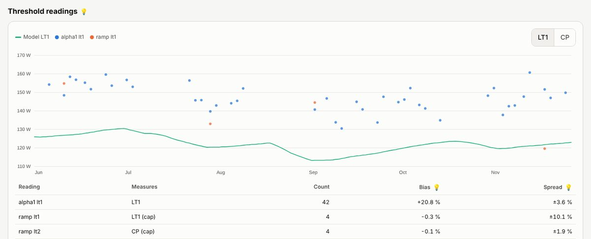
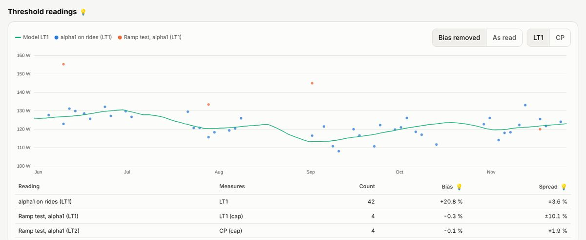
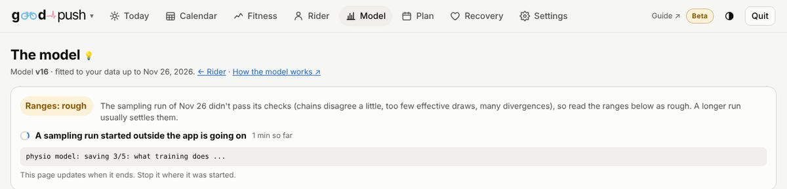
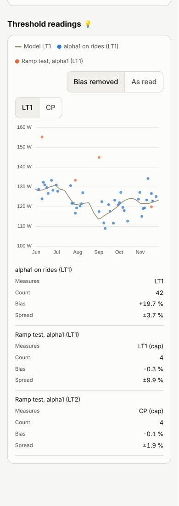

# Model page: design critique and fixes

A design critique of the Model page (`#model`), done on 2026-11-27 against `main` after the Tailwind CSS + daisyUI
restyle, and the fixes for its five highest-priority findings. The other findings are listed at the end for later.

**How it was checked:** a synthetic rider (`goodpush synth new`, 180 days, 86 rides) with `goodpush run`, then a
short sampling run (`goodpush physio --nuts --samples 150 --warmup 120`), so the page showed both the "best fit only"
state and the "sampling run didn't pass its checks" state. The page was captured with Playwright at 1366 × 860 and
at iPhone 13 width, in light and dark mode, and contrast was measured on the rendered page. It had no console errors
and no horizontal scroll. The backtest and coverage sections weren't covered, because they need hour-long runs.

## Overall impression

The page is careful and honest. It shows uncertainty, bias, and how far the model can be trusted, which most training
apps hide. The biggest opportunity was to make it answer its own question at the top. Its hint says the question is
*"Can you trust the physiology model behind the Rider page and the plan?"*, but the page opened with a version number
and two tiles that gave opposite answers about the ranges.

## The five fixes

### 1. One answer about the ranges, at the top

**Before:** Status had two tiles both labelled **Ranges**. After a sampling run, the first said "Nov 26, 2026" (it has
ranges) and the second said "not yet" (they can't be trusted). Before a run they said "none" and "none yet". The
"Run sampling + backtest" button sat alone in a full-width strip between them, and "Today, with its uncertainty"
showed its 5–95 % ranges with no warning.

**After:** a single verdict card opens the page: **Ranges: none yet / rough / trustworthy / from an earlier run**,
with one sentence on why and the run button underneath it. The button is the primary action only when the ranges
need a run. Status keeps Version, Fitted to and Backtest, plus the forecast-check tiles when there are any. Dates are
short ("Nov 26"), so the tiles no longer wrap. When the checks failed, the uncertainty table says its ranges are rough.

### 2. Predicted vs observed reads as predicted vs observed

**Before:** neither axis had a title, and the two axes used different ranges (x 220–264 W, y 100–300 W). The
"observed = predicted" line came out almost flat, so "on the line" and "well above it" were hard to judge.

**After:** both axes are titled (*Predicted: the model's all-out power that day*, *Observed: your best*) and share one
range and tick step, so the identity line runs corner to corner. This uses three new `EChart.draw` options in
`charts.js` (`xName` / `yName`, `yDomain`, `tick`), which other charts can use too.

### 3. Intensity colours keep their order in dark mode

**Before:** the intensity scale (`--z1` … `--z7`) ran yellow (easy) → navy (hard) in light mode, but slate (easy) →
bright yellow (hard) in dark mode. The scale flipped, so in dark mode the hardest riding got the colour that meant
easiest in light mode. This shows on the Model, Rider, Calendar and Ride pages.

**After:** dark mode keeps the yellow → blue order, with lighter blues that stay visible on the dark background
(each at least 4.2:1 against the card). Text drawn on those colours uses new `--on-z1/3/5/7` tokens, so it stays
readable in both themes.

### 4. Threshold readings on the same footing as the model

**Before:** the chart drew raw alpha1 readings around 145 W above a model LT1 line around 122 W. The +20.8 % bias
that explains the gap was only in the table underneath, so at a glance the model looked about 20 W off. Sources had
code names (`alpha1 lt1`, `ramp lt2`).

**After:** a **Bias removed / As read** switch (bias removed by default, remembered per browser) divides each reading
by its source's learned offset, so readings can be compared with the model's line. Sources have plain names
("alpha1 on rides (LT1)", "Ramp test, alpha1 (LT2)", "FTP you entered"…) in the legend, the tooltip and the table.

### 5. Progress for a sampling run started elsewhere

**Before:** while a sampling run from a terminal (or the weekly ranges refresh) was going, the button just greyed out
with "Another sampling run is going on … wait for it to end". Nothing on the page changed until it was reloaded, even
though the run itself prints its progress.

**After:** a NUTS run now writes its start and last progress line to `processed/physio_nuts_progress.log` while it
holds the NUTS lock (`PhysioRun.tracked`). Peer sync already skips `*.log`. `/api/model_run` returns it as
`other`, and the page shows "A sampling run started outside the app is going on · 4 min so far", with that line. It
keeps polling and reloads the model when the run ends.

## Second pass (after upstream 0.4.1)

Most of the other findings were fixed in a second pass:

| Finding | Severity | Done |
|---|---|---|
| Phone: the riding table and the threshold table were cut off on the right, with no sign that they scroll | Moderate | Both become one card per row on a phone (`table.stacktable`; `.kv` puts short values beside their names) |
| Fatigue y axis (0–4) had no unit | Minor | Titled "Recent hours at CP" |
| Red was used for "training explains part of the change" | Minor | Amber for part or "too small", red only when training explains little (under 20 %) |
| "What each kind of riding did for you" was a blue disclosure styled unlike every other section, yet open by default | Minor | An ordinary sub-heading under "What training explains" |
| The sections mixed "can I trust it?" with "what it says about you" | Minor | Two groups under the verdict: *What the model says about you* (today's ranges, fatigue, training), then *How far to trust it* (status, sampler, predicted vs observed, readings) |
| Mixed date formats ("2026-11-27 17:00" in sampler details) | Minor | "Sampling run of Nov 27, 17:00" |
| The three main charts had no text alternative | Moderate (a11y) | `EChart.draw(..., {label})` sets `role="img"` and an `aria-label` with a one-sentence summary (now, highest, how many efforts sit above the prediction) |
| Hard ride, Test and Heart rate maxed were told apart by colour only | Minor (a11y) | Circle, diamond and triangle markers, with the same shapes in the legend |
| Segmented buttons were 40 px tall | Minor (a11y) | 44 px on phones |
| Range bars used a different hue per row | Minor | Upstream's zone colour map (0.4.1) now colours them by intensity |

Still open: the 💡 hints (25 after a sampling run) could become one-line captions where they hold a section's main
idea. That's a copy change best made with the guide's author.

## What works well

* The page shows its doubts: ranges, divergences, bias and spread, and "≈ as assumed" where the data barely moved a
  prior.
* "Today, with its uncertainty" is the clearest section: median, range and a bar each, with "assumed" chips where a
  value isn't learned.
* Sampler details sits behind a disclosure, so experts can check R-hat and chain traces without cluttering the page.
